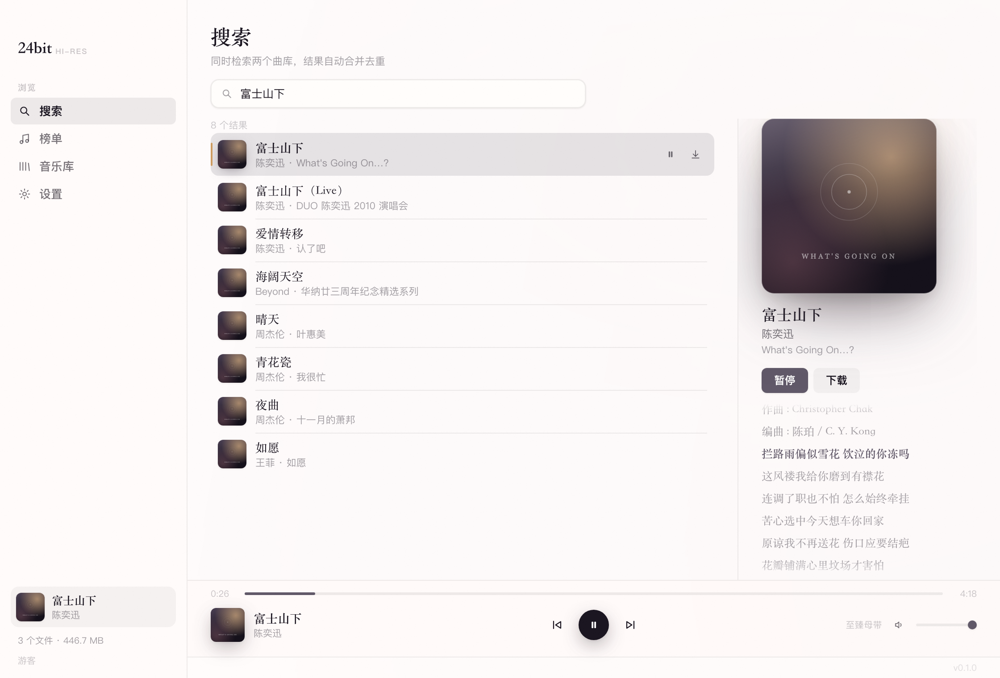

# 24bit

非官方的 [24bit.net](https://www.24bit.net)（Hi-Res 无损音乐直链站）客户端。**全部 Rust**，四个 crate：

| crate | 作用 |
|-------|------|
| `twentyfourbit-core` | HTTP API 客户端：搜索、详情、下载（断点续传）、周榜、登录、LRU 缓存、配置 |
| `twentyfourbit-player` | 音频引擎：symphonia 解码 → rubato 窗函数 sinc 重采样 → cpal 输出，支持暂停/seek/音量 |
| `twentyfourbit-cli` | 命令行工具，二进制名 `24bit` |
| `twentyfourbit-tauri` | 桌面客户端，二进制名 `24bit`（Tauri + React） |

## 快速开始

```sh
cargo build --release

./target/release/24bit                            # 桌面客户端
./target/release/24bit search 富士山下            # 命令行
```

macOS 打包成可双击的 `.app`：

```sh
./scripts/build-app.sh        # 产出 dist/24bit.app
```

## 桌面客户端

浅色、近乎单色的界面：白纸作内容面、浅灰作外壳、近黑作强调色。屏幕上唯一的彩色来自专辑封面。



单窗口三栏布局：左侧导航（搜索 / 榜单 / 音乐库 / 设置），中间列表，底部固定播放条。

- **搜索**：自动合并站点两个独立曲库并按 `(歌名, 歌手)` 去重；输入停 300ms 自动搜，回车立即搜
- **歌词**：母带档自带 LRC，右侧面板跟随播放逐行高亮并自动居中，点某行直接跳到那句
- **播放**：双击或点「播放」，音频在后台线程解码 → 重采样 → 输出；播放条可暂停、拖动 seek、调音量，显示封面与实时输出采样率
- **下载**：搜索结果点「下载」导出到 `~/Music/24bit`，文件名是「歌名 - 歌手 [专辑].flac」
- **榜单**：周歌曲榜与歌手榜，点歌名直接搜
- **音乐库**：已缓存曲目，显示真实歌名（来自缓存侧车元数据），可离线播放
- **设置**：音质偏好、缓存占用、清空缓存、登录

界面全中文，字体从系统字体库自动探测（见下文「中文字体」）。

## 命令行

```sh
24bit search 富士山下            # 搜索
24bit search 周杰伦 --limit 5 --json
24bit charts                     # 周榜
24bit track <id>                 # 详情（含签名直链及过期时间）
24bit download <id> -o out.flac  # 下载
24bit download <id> --quality surround
24bit play <id>                  # 播放（走缓存，二次播放零流量）
24bit login <account> --password <pw>
24bit config show | set-quality | path
```

## 缓存

母带一首约 150MB，重复下载不可接受。缓存默认在 `~/Library/Caches/24bit`（Linux 为 `~/.cache/24bit`）：

```
master/<track-id>.flac      音频
master/<track-id>.json      元数据侧车（歌名/歌手/音质/歌词）
master/<track-id>.flac.part 未完成的下载
```

- **二次播放零网络请求**，连歌名都不用再查
- 按 `id + 音质档` 分键：母带与环绕声互不覆盖
- 超预算按 **LRU 淘汰**，且「命中即续命」——刚播过的不会被删
- `.part` 永不淘汰（不能为了腾地方毁掉下了一半的 150MB）
- 0 字节文件视为未缓存（崩溃不会留下「已缓存」的空文件）
- id 会被净化，恶意 id 无法逃出缓存目录

上限默认 5GB。

## 播放质量

站点母带是 24bit/192kHz，绝大多数输出设备不接受。播放器在打开硬件**之前**先算出输出采样率：

- 设备支持原生采样率 → 直通
- 不支持 → **rubato 窗函数 sinc 重采样**（256 taps, Blackman-Harris2）

实测（`tests/resampler.rs`，用正弦波频率作为独立真值）：

| 输入 | 结果 |
|------|------|
| 1kHz @192k → 48k | 输出 1001Hz（误差 0.13%） |
| 440Hz @44.1k → 192k | 输出 440.5Hz |
| 30kHz @192k → 48k | 残余峰值 0.0000（完全滤除） |

最后一行是关键：旧的箱式滤波会把 30kHz 折叠成 18kHz 的全幅假信号，sinc 直接滤掉。

## 站点 API（逆向所得，无官方文档）

全部端点：`POST https://www.24bit.net/api/<path>`，JSON body，响应 `{"status": bool, "result": ...}`。

| 端点 | body | 说明 |
|------|------|------|
| `/player/searchOnlineMusicOne` | `{keyword, page}` | 曲库一，30 条/页 |
| `/player/searchOnlineMusicTwo` | `{keyword, page}` | 曲库二（与一不同） |
| `/music/findMusicPage` | `{type, id, ip}` | 详情 + 签名直链；`type` = `a`(母带)/`c`(环绕声)；`ip` 必填但值不校验 |
| `/player/findWeekRecord` | `{}` | 周榜 |
| `/user/login` | `{account, password}` | 返回 token，放 `Token` header |
| `/user/getUserStatus` | — | 随 `Token` header 查询 |
| `/music/getTodayMusicCount` | — | 今日已下载次数 |

下载直链指向 `iot*.music.126.net`，路径里带 `YYYYMMDDhhmmss` 过期戳，过期返回 403。支持 Range 续传。游客即可搜索、取直链、下载。

**已处理的坑：**

1. CDN 把 FLAC 标成 `audio/mpeg` —— 扩展名取自 `format` 字段，不看 Content-Type。
2. `findMusicPage` 强制要求 `ip` 字段，值随便填。
3. 站点会间歇性重置连接 —— 默认重试 3 次，但只对网络错误/5xx/429 重试；`status:false` 是业务答复，重试没意义。
4. 签名直链过期 → 自动重取详情重试**一次**（这是唯一保证有效的重试）。
5. `searchOnlineMusicThree` 已失效（超时），母带档 `type=b` 服务端 500 —— 都不建模。

## 中文字体

egui 只自带拉丁字体，不处理会满屏豆腐块。程序在系统字体库里按优先级查找：
PingFang → Hiragino Sans GB → Microsoft YaHei → Noto Sans CJK → 思源黑体 → …，
并正确使用 `.ttc` 集合内的 face index。找不到时界面会明确提示，而不是静默画方块。

## 测试

```sh
cargo test        # 143 个测试，默认全部离线
```

真站集成测试（需联网，默认忽略）：

```sh
cargo test -p twentyfourbit-tauri --test live -- --ignored --nocapture --test-threads=1
```

它们验证逆向出的 API 仍然成立：搜索返回 48 条、周榜 10 首、签名直链可 Range 读取、
以及二次解析不重新下载（实测下载 3.96s / 缓存命中 197µs）。**请串行跑** —— 并发下载对第三方站点不礼貌。

大部分测试离线运行（wiremock + 抓取的真实响应 fixtures），期望值来自真实服务器响应而非实现本身。

少数测试驱动真实音频硬件并断言**时序**——2 秒音频必须花约 2 秒播完。这类测试在无声卡环境会失败，这是刻意的：把播放路径换成非实时实现，它们必须报警。

## License

MIT OR Apache-2.0

---

非官方客户端，与 24bit.net 无关联。站点靠会员费运营（游客每天限数首），请自行判断使用边界。
